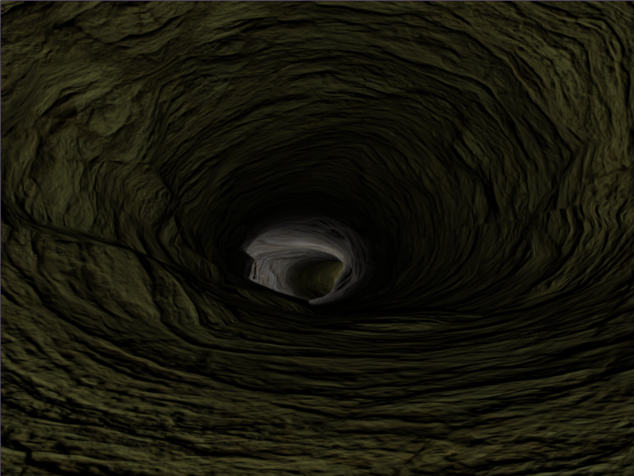
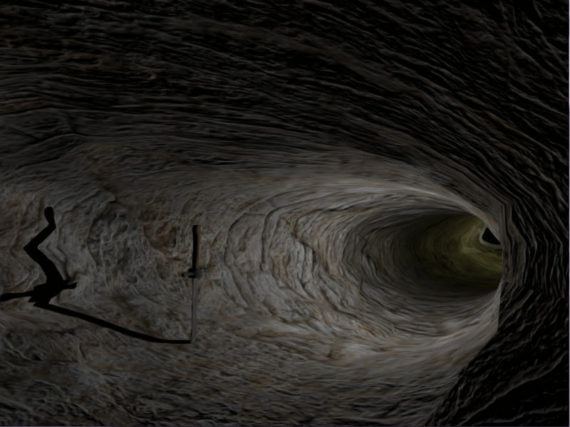
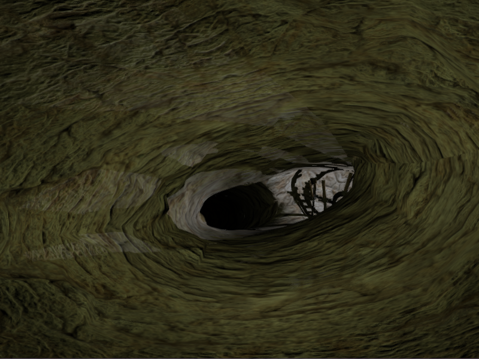
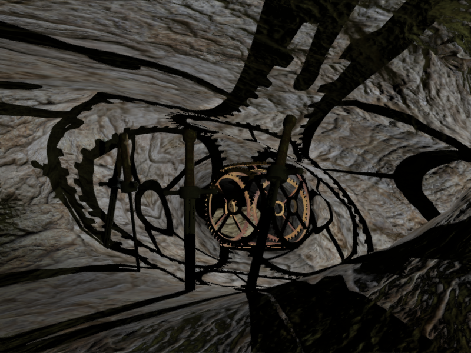
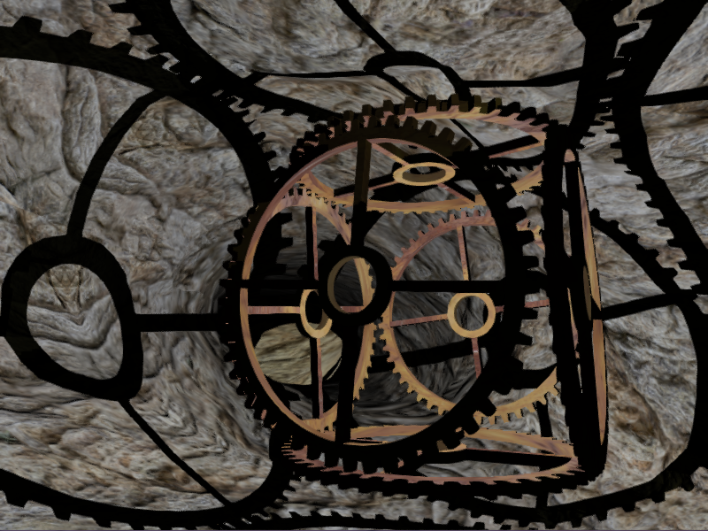
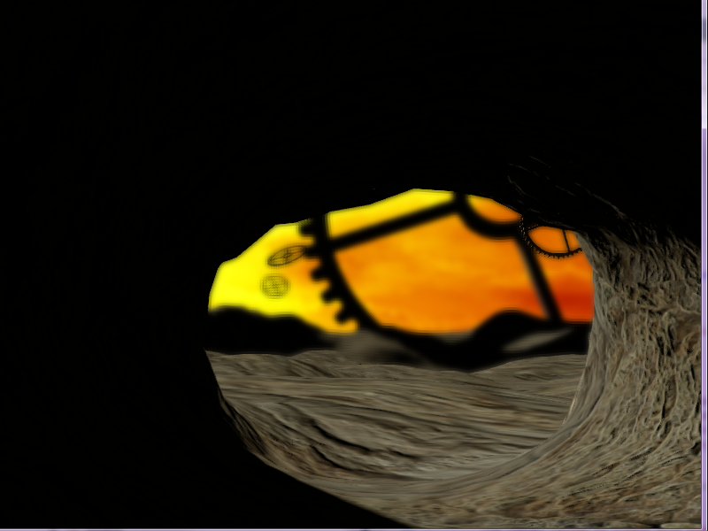
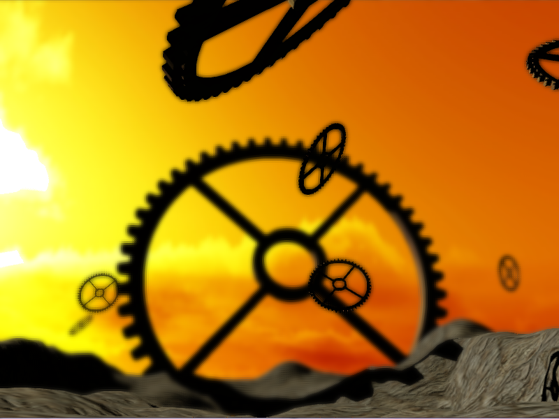
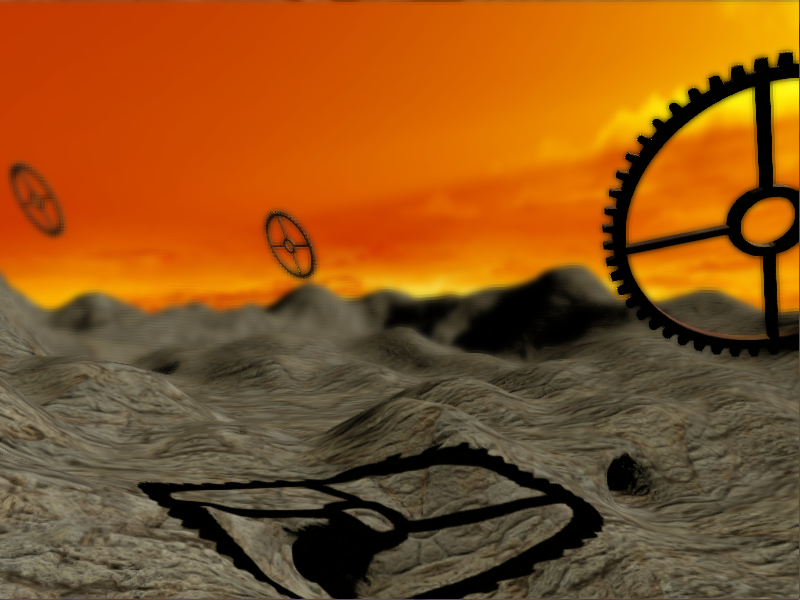
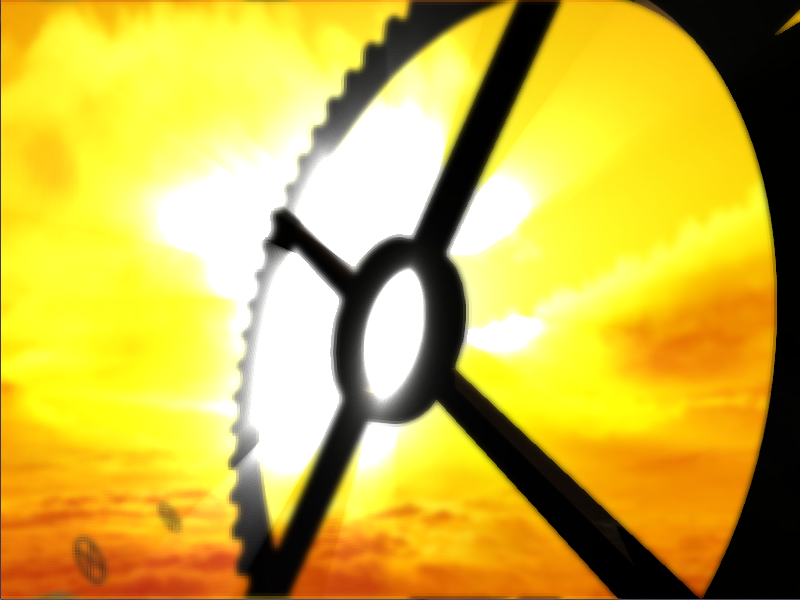
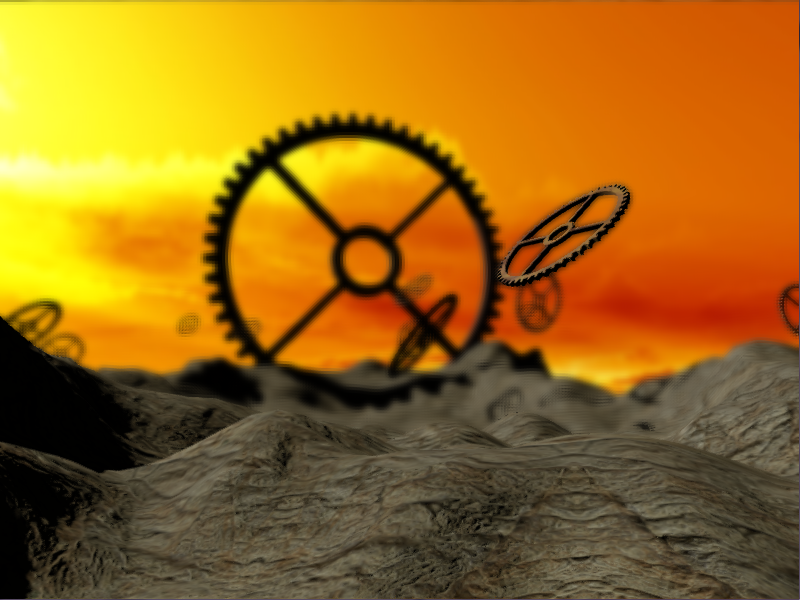

# Introduction

This demo was created for the realtime rendering university course. It features a data driven deferred OpenGL based renderer with post processing capabilities.

The original version of this project is preserved at the [`v1`](https://github.com/redagito/RTR2014/tree/v1) tag.



## Features
* Deferred rendering
* Point lights
* Directional lights
* Normal mapping
* Shadow maps
* Omnidirectional shadows
* Depth of field effect
* FXAA
* In-game scene editor with save back to the scene file



# Building

## Prerequisites

* CMake 3.28 or newer
* Conan 2
* A C++23 capable compiler
* An OpenGL 4.6 capable GPU and driver



## Debug build

```
conan install . --build=missing -s build_type=Debug
cmake --preset conan-default
cmake --build build --config Debug
```



## Release build

```
conan install . --build=missing -s build_type=Release
cmake --preset conan-default
cmake --build build --config Release
```

# Running



The demo reads its data from the `data` folder, it is started from the project directory or from the directory the data was copied to.

```
build/App/Release/RTRDemo.exe
```



## In-game scene editor

Press `Tab` while the demo is running to open the scene editor. It scans `data/mesh` for `.obj` files and `data/material` for `.ini` files, spawns the selected combination in front of the camera and lets you adjust the models it spawned. While the editor is open, the overlay lists all of its controls on screen, so they do not have to be remembered; the list replaces the normal demo rows until the editor is closed.

| Key | Action |
| --- | --- |
| `Tab` | Open or close the editor |
| `,` / `.` | Previous or next mesh |
| `F7` / `F8` | Previous or next material |
| `Enter` | Spawn the selected mesh and material in front of the camera |
| `PgUp` / `PgDn` | Select the previous or next spawned model |
| `H` / `L` | Move the selected model along X |
| `J` / `K` | Move the selected model along Z |
| `Home` / `End` | Move the selected model down or up |
| `1` / `2` / `3` | Rotation axis X, Y or Z |
| `X` / `V` | Rotate around the selected axis |
| `F9` / `F10` | Scale the selected model down or up |
| `Delete` | Remove the selected model |
| `F6` | Save the scene |

The editor bindings avoid shifted punctuation keys and the swapped `Y`/`Z` letters, so they work on German QWERTZ keyboards as well as US layouts. They are reserved for the editor and do not overlap with the camera or demo shortcuts.

Saving appends the models to the `scene_objects` of the scene file that was loaded. Lights, sky, music, sound emitters, animations and the objects that were already in the file are preserved. Before the file is overwritten, its previous version is written next to it with the `.bak` suffix. Repeated saves replace the objects of the previous save instead of duplicating them. The editor only changes the models it spawned; the objects loaded from the file stay untouched.

The demo reads and writes its data relative to the working directory. When it runs from the build directory, the editor saves to the `data` copy next to the executable, not to the `data` folder in the source tree.

## Capturing a frame

The capture mode renders a number of frames without showing the window and writes the last one to a PNG file. The frames are rendered with a fixed time step, so that the same image is written every time.

```
build/App/Release/RTRDemo.exe --capture shot.png --frames 2400
```

The number of frames selects the point on the camera sequence of `data/democam.json` that is captured, one frame is a sixtieth of a second.



## Taking a screenshot

While the demo is running, press `F12` to write the current frame to `screenshots/<timestamp>_<frame>.png`. A JSON file with the same name next to it records the camera, window, mouse, camera sequence and debug overlay state.

The `screenshots` folder is created on demand and is not tracked by git. The images in `docs/screenshots` are the gallery above.


